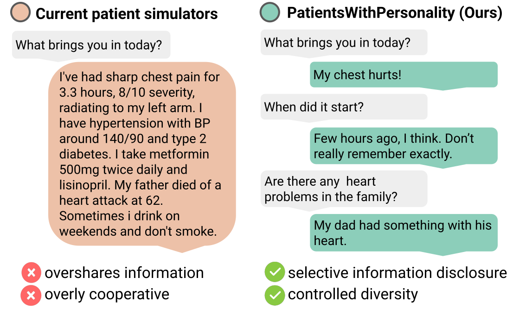
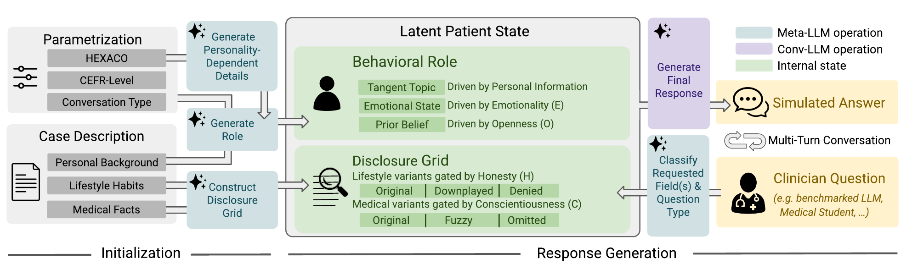
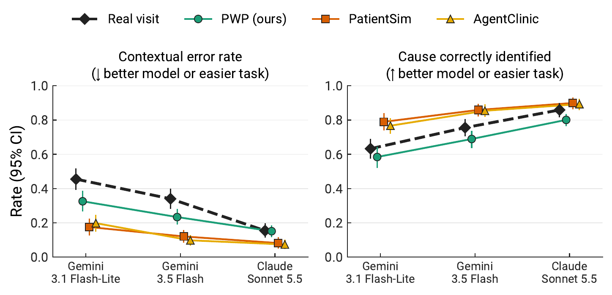

<div align="center">

# 🩺 Patients With Personality

### Realistic Patient Simulation through Controlled Diversity and Selective Disclosure

[Moritz Schlager](https://scholar.google.com/citations?user=lMvbxhoAAAAJ&hl=en), [Friederike Jungmann](https://kiinformatik.mri.tum.de/de/team/friederike_jungmann), [Samuel Schmidgall](https://scholar.google.com/citations?user=bQDooZEAAAAJ&hl=en), Philipp Raffler, Franziska Hartl, Eva Wende, Paula Roßmüller, Conrad Ketzer, Matthew Thompson, Justin Anthony Chen, Christina Chen, [Avinatan Hassidim](https://scholar.google.com/citations?user=CnBvgwcAAAAJ&hl=en), [Dale R. Webster](https://scholar.google.com/citations?user=qAqGfk0AAAAJ&hl=en), [Yossi Matias](https://scholar.google.com/citations?user=IwSe1-MAAAAJ&hl=en), [Yun Liu](https://scholar.google.com/citations?user=EojZy50AAAAJ&hl=en), [Daniel Rueckert](https://scholar.google.com/citations?user=H0O0WnQAAAAJ&hl=en), [Mike Schaekermann](https://scholar.google.com/citations?user=mwj_ldQAAAAJ&hl=en), [Paul Hager](https://scholar.google.com/citations?user=ESLUtGAAAAAJ&hl=en)

**ML4H 2026 · Proceedings Track**

<p>

[](https://arxiv.org/abs/2606.17441)
[](https://mo374z.github.io/PatientsWithPersonality/)
[](https://patient-simulator-demo-4os25b5fpq-ew.a.run.app/)
[](https://www.python.org/)
[](https://github.com/astral-sh/uv)

</p>

</div>

---

This repository contains the full code for the paper: the **PWP simulator**, **re-implementations of prior patient simulators** under a shared interface, the **physician-aligned evaluation pipeline** on real VHA encounters, the **clinician study** GUI and analysis, the **contextual-care downstream benchmark**, and a **live demo**.

## Motivation

<p align="center">
  
</p>

Realistic patient simulation is needed to benchmark clinical LLMs at scale without costly user studies. Yet existing simulators behave unlike real patients: prompted with a single question, they volunteer the entire case in one overly cooperative turn, and they lack the imperfect recall and personality-driven variation of real encounters. PWP decouples behavioral personality from information disclosure, so a simulated patient reveals what it is asked, the way it would given its personality.

## Highlights

- 🧬 **Parametrizable personas** — six HEXACO axes (Honesty-Humility, Emotionality, eXtraversion, Agreeableness, Conscientiousness, Openness) plus language proficiency control conversational style, cooperativeness, and disclosure.
- 🤐 **Selective disclosure** — a query-conditioned disclosure grid keeps unrequested facts out of the prompt; PWP reproduces the disclosure pacing of real patients.
- 👩‍⚕️ **Judged realistic by clinicians** — in a blinded study on real VHA primary-care encounters, clinicians judge PWP realistic at least as often as the recorded encounters themselves and far more often than prior simulators, and almost never flag it as *too informative*.
- 🎭 **Recoverable, diverse personalities** — configured traits are recovered by clinicians and two independent LLM judges, and PWP personas span a wider behavioral range than the closest parametrizable baseline.
- 🏥 **Realistic benchmark difficulty** — on a contextual-care benchmark built from human expert labels, PWP stays closest to the task difficulty of the real visit across three LLMs, while prior simulators make the task too easy and compress the differences between models.

## Framework

<p align="center">
  
</p>

PWP separates a one-time **initialization** from per-turn **response generation**, mediated by a **latent patient state**.

**Initialization.** A structured case description (personal background, lifestyle habits, medical facts) and a parametrization θ = (h, e, x, a, c, o, l) are turned by a meta-LLM into

- a **behavioral role** — tangent topics drawn from personal information (X), an emotional state (E), and a prior belief (O), synthesized by a tuned latent-role prompt;
- a **disclosure grid** — lifestyle facts in *original / downplayed / denied* variants gated by Honesty-Humility (H), and medical facts in *original / fuzzy / omitted* variants gated by Conscientiousness (C) that unmask progressively under targeted questioning.

**Response generation.** For each clinician turn, the meta-LLM classifies which case fields are requested and the question form (polar, open, statement); only the requested fields enter the prompt, in the variant the latent state selects, and the conversational LLM generates the answer as a *spoken* or *written* patient.

## Patient Simulators

All simulators share one interface in [`patient_simulator/patients/`](patient_simulator/patients/).

| Simulator | Reference | Summary |
|---|---|---|
| **PatientsWithPersonality** | *Ours* | HEXACO-parametrized latent role and query-conditioned disclosure grid. |
| `RealPatient` | — | *Human Reference*: replays the recorded patient turns verbatim. |
| `BaselinePatient` | — | *Human Rephrase*: LLM paraphrase of the recorded patient turns. |
| `AgentClinicPatient` | [Schmidgall et al., 2026](https://arxiv.org/abs/2405.07960) | Prompt-based patient agent of the AgentClinic benchmark, with optional cognitive and social biases. |
| `PatientSimPatient` | [Kyung et al., 2025](https://arxiv.org/abs/2505.17818) | Persona axes: personality, CEFR level, recall, dazedness. |
| `CraftMDPatient` | [Johri et al., 2025](https://www.nature.com/articles/s41591-024-03328-5) | Prompt-based simulation, one layman sentence per answer. |
| `StateAwarePatient` | [Liao et al., 2024](https://arxiv.org/abs/2403.08495) | State tracker with a three-tier memory bank. |
| `VirtualPatient` | [Zhang et al., 2026](https://arxiv.org/abs/2511.14783) | System prompt rebuilt each turn from a JSON case and a history window. |

## Installation

The project uses [`uv`](https://github.com/astral-sh/uv) and targets Python 3.12.

```bash
git clone https://github.com/mo374z/PatientsWithPersonality.git
cd PatientsWithPersonality
uv sync
```

Model backends are configured in [`configs/experiment/models/`](configs/experiment/models/). Gemini and Claude run through Vertex AI: authenticate with `gcloud auth application-default login` and set `GOOGLE_CLOUD_PROJECT` (or `GOOGLE_CLOUD_API_KEY` for the Gemini API). OpenRouter keys go into `keys.json` (`cp keys.json.example keys.json`). The meta-LLM (`Ministral-3-14B`) runs locally through vLLM.

## Data

All experiments run on the public VHA *Physician-patient transcripts with 4C coding analysis* ([data.va.gov, CC0](https://www.data.va.gov/dataset/Physician-patient-transcripts-with-4C-coding-analy/4qbs-wgct)): 405 de-identified primary-care transcripts with *Contextualizing Care* annotations. Place the raw transcripts in `data/vha/Transcripts/` and the 4C annotation sheet at `data/vha/four_c_narratives.xlsx`. The domain-term count uses the Open Access Consumer Health Vocabulary, expected at `data/CHV_concepts_terms.csv`.

The repository ships the case lists the paper uses (`data/vha/*.txt`), the tangent topics and the initial prompts for meta-prompt tuning; everything else under `data/` is derived by the steps below.

| Step | Command |
|---|---|
| Clean transcripts, extract case descriptions | [`notebooks/preprocess_vha.ipynb`](notebooks/preprocess_vha.ipynb) |
| Estimate missing ages | `scripts/impute_vha_ages.py` |
| Select the 30 evaluation cases | `scripts/select_vha_cases.py` (exact call in `configs/experiment/patient_comparison_vha.yaml`) |
| Build the held-out tuning split | `scripts/create_vha_tuning_dataset.py` |
| Inject 4C red flags for the downstream benchmark | `scripts/create_vha_4c_profiles.py` (`configs/experiment/vha_4c_profiles.yaml`) |
| ACI-Bench (replication) | [`notebooks/preprocess_aci_bench.ipynb`](notebooks/preprocess_aci_bench.ipynb) |

## Reproducing the paper

Experiments are configured with [Hydra](https://hydra.cc/) in [`configs/experiment/`](configs/experiment/) and write to `results/<experiment>/`; analysis notebooks read from there.

| Result | Run | Analysis |
|---|---|---|
| Meta-prompt tuning of the latent role (App. D) | `scripts/run_metaprompt_tuning.py` | `eval_metaprompt_tuning.ipynb` |
| Physician-aligned simulator comparison, dialogue metrics, disclosure (Sec. 5.1, App. F) | `scripts/run_vha_sharded.sh` with `CONFIG=patient_comparison_vha`, then `scripts/run_posthoc_eval.py --config-name posthoc_eval_vha` | `eval_sim_comparison.ipynb` |
| Clinician realism and personality study, inter-rater agreement (Sec. 5, App. E) | `labeling-gui/app.py` | `eval_doctor_study.ipynb` |
| Extreme personalities and behavioral diversity (Sec. 5.2) | `patient_comparison_vha` | `eval_personality.ipynb` |
| Personality recovery: judge-prompt, turn-window and independent-judge ablations | `scripts/run_personality_ablation.py --config-name personality_ablation_vha` (and `..._judge_claude_sonnet_5_5`) | `eval_personality_ablation.ipynb` |
| Ablations of the default configuration (all center, A = 1, disclosure grid off) | `CONFIG=patient_comparison_vha_ablation`, `posthoc_eval_vha_ablation` | `eval_sim_comparison.ipynb` |
| Replication on ACI-Bench | `scripts/run_patient_comparison.py --config-name patient_comparison_default`, `posthoc_eval` | `eval_sim_comparison.ipynb` |
| Contextual-care downstream benchmark | `scripts/run_contextual_care_benchmark.py --config-name contextual_care_vha` (and `contextual_care_vha_ext`, `contextual_care_vha_persona`) | `eval_contextual_care.ipynb` |

`run_vha_sharded.sh` runs the PWP arms in one vLLM process and splits the API-only simulators across processes; merge the shards with `scripts/merge_result_shards.py`.

### Contextual-care benchmark

Many clinical problems have a non-medical cause — a patient's diabetes is uncontrolled because they dislike pricking their finger. A plan that ignores it is a *contextual error*. For 92 VHA cases (206 coded contextual factors), each red flag and its expert-coded factor is added to the case description. A doctor LLM is briefed with the clinician-observable red flags only, interviews the simulated patient, and states the cause and a plan for every flag; a judge scores them against the coding. The same doctor LLM reasoning over the transcript of the real visit is the reference: a simulator that makes the interview easier than the real visit makes the benchmark easier than reality.

<p align="center">
  
</p>

With PatientSim and AgentClinic every doctor model makes significantly fewer contextual errors than on the real visit; PWP is on average 0.08 away from the real error rate against 0.19 for both baselines, and keeps the gap between the strongest and weakest doctor model that the baselines compress. PWP matches the real error rate for Claude Sonnet 5.5 but is still easier than the real visit for both Gemini doctors.

## Interactive tools

### Live demo

Try to diagnose a simulated patient with your own HEXACO configuration via our small [demo app](https://patient-simulator-demo-4os25b5fpq-ew.a.run.app/). To run the simulator locally with any configuration, use the playground below.

### Simulator playground & evaluation explorer (Streamlit)

```bash
uv run streamlit run frontend/app.py --server.port 8555     # chat with any simulator
uv run streamlit run frontend/evaluation_explorer.py        # inspect evaluated conversations
```

### Clinician labeling GUI (Dash)

```bash
uv run python labeling-gui/app.py \
  --results-dir results/patient_comparison_vha/ \
  --study-config labeling-gui/study_config_vha.yaml \
  --data-dir data/vha/
```

Labels are written to `labeling-gui/labels_vha/<rater>/`. The clinicians' raw labels are not released; `eval_doctor_study.ipynb` keeps the aggregate results as stored outputs.

## Repository structure

```
patient_simulator/      Core library
  patients/             Simulator implementations (PWP + baselines)
  prompts/              Patient and evaluation prompts
  misc/                 LLM clients, metrics, plotting, study analyses
  eval.py               Per-conversation evaluation metrics
  data_extraction.py    Case-description extraction from transcripts
configs/experiment/     Hydra experiment and model configs
scripts/                Experiment entry points and data preparation
notebooks/              Preprocessing and analysis notebooks
labeling-gui/           Dash clinician labeling app
frontend/               Streamlit playground and evaluation explorer
docs/                   Project page
tests/                  Design checks for the clinician-study assignments
```

## Citation

If you find this work useful, please cite:

```bibtex
@misc{schlager2026patients,
  title     = {Patients With Personality: Realistic Patient Simulation through Controlled Diversity and Selective Disclosure},
  author    = {Schlager, Moritz and Jungmann, Friederike and Schmidgall, Samuel and Raffler, Philipp and Hartl, Franziska and Wende, Eva and Ro{\ss}m{\"u}ller, Paula and Ketzer, Conrad and Thompson, Matthew and Chen, Justin Anthony and Chen, Christina and Hassidim, Avinatan and Webster, Dale R. and Matias, Yossi and Liu, Yun and Rueckert, Daniel and Schaekermann, Mike and Hager, Paul},
  year={2026},
  eprint={2606.17441},
  archivePrefix={arXiv},
  primaryClass={cs.HC},
  url={https://arxiv.org/abs/2606.17441}, 
}
```
